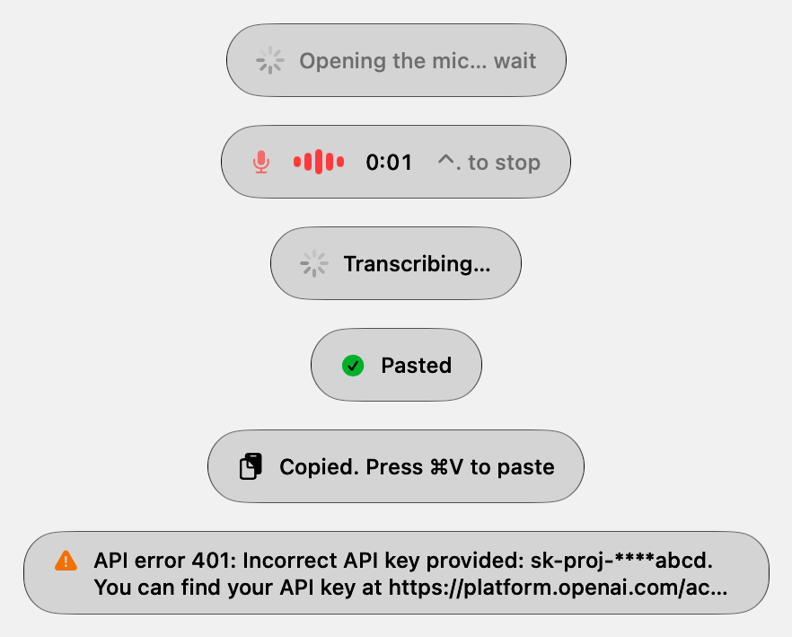
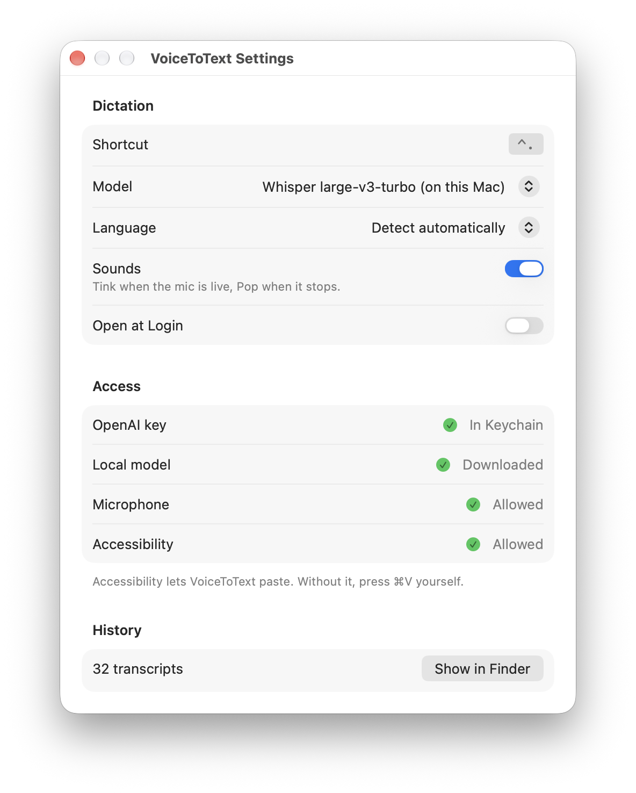

# VoiceToText

Push-to-talk dictation for macOS. Press **⌃.** (control + period), speak, press **⌃.** again: the text is pasted where
your cursor is. It transcribes with OpenAI, or fully offline on your Mac with Parakeet Ultra (the fastest) or Whisper
large-v3-turbo.

A native Swift menu bar app with no Dock icon and no main window. The original Hammerspoon + bash version is still in
this repo ([below](#legacy-hammerspoon--bash-version)).

<p align="center">
  <picture>
    <source media="(prefers-color-scheme: dark)" srcset="docs/screenshots/hud-states-dark.png">
    
  </picture>
  &nbsp;&nbsp;
  <picture>
    <source media="(prefers-color-scheme: dark)" srcset="docs/screenshots/settings-dark.png">
    
  </picture>
</p>

## Features

- **One shortcut**, ⌃. to start and ⌃. to stop. Works in any app. Change it in Settings › Shortcut › Change… (Reset goes back to ⌃.).
- **Pastes at the cursor.** The text also stays on the clipboard.
- **Two kinds of model:**
  - OpenAI: `gpt-4o-transcribe`, `gpt-4o-mini-transcribe`, `whisper-1`.
  - Local, no key, no network, no cost:
    - **Parakeet Ultra** through FluidAudio, on the Neural Engine. The default and the fastest: text 0.07 s after you
      let go of a short dictation, 0.18 s after 23 s.
    - **Whisper large-v3-turbo** through whisper.cpp.
- **Any language** the model supports. Detects the language by default, or set one (English, Spanish, Catalan, French, German, Italian, Portuguese).
- **A small pill at the bottom of the screen** while dictating, with a level meter and a timer, then "Pasted", "Copied" or the error. It never takes focus, so the text lands in the app you were typing in.
- **Menu bar icon** that shows the state: a waveform when ready, the input level and a timer while recording (not a second mic next to macOS's orange one), three moving dots while transcribing, then ✓ or ✕ for a moment. A red dot stays after a failed try until you open the menu.
  - **Click Icon to Dictate** (Settings, off by default): a click starts and stops; right-click or ⌥-click opens the menu.
  - **Hide Icon When Idle** (Settings, off by default): the icon shows only while dictating or after a failure. Open the app again for Settings.
  - **Drop an audio or video file** on the icon to transcribe it: the text is copied and saved to history.
- The menu has:
  - Start Dictation, Stop and Paste, Cancel Recording, and Retry Last Recording (re-sends it after an error).
  - The last 5 transcripts (click one to copy it).
  - Open History, Settings (⌘,) and Quit.
- **Sound cues**: Tink when the mic is live, Pop when recording stops.
- **History** of every transcript in a Markdown file.
- **Agent CLI and MCP server** (`vtt`) so scripts and AI agents can record, transcribe and read the history.

## Requirements

| What | Version | Notes |
|---|---|---|
| macOS | **26 (Tahoe) or later** | `LSMinimumSystemVersion` 26.0. Tested on macOS 27.0.1. |
| Mac | Apple Silicon recommended | Tested on an M4 Pro. Intel is untested. |
| Build tools | Xcode Command Line Tools with Swift 6.2+ | Built and tested with Swift 6.4 (CLT 27.0). Full Xcode is not needed. |
| OpenAI API key | | Only for the OpenAI models. |
| Homebrew + whisper.cpp | whisper.cpp 1.9.5 tested | Only for local Whisper. `tools/get-model.sh` installs it. |
| Disk | ~1.7 GB (Whisper), 610 MB (Parakeet) | Only for the local models you use. Parakeet downloads itself the first time you pick it. |

## Permissions

| Permission | Where to grant | Why | Without it |
|---|---|---|---|
| **Microphone** | Asked on the first recording. System Settings › Privacy & Security › Microphone | To record you | Nothing is recorded |
| **Accessibility** | Settings › Allow, or System Settings › Privacy & Security › **Accessibility** (called **Device Control and Data Access** on macOS 27) | To press ⌘V in the app you are typing in | The text is only copied; you press ⌘V |
| Keychain | None (no prompt) | Reads the OpenAI key through `/usr/bin/security` | Uses `OPENAI_API_KEY` from the environment, or the local model |
| Login item (optional) | Settings › Open at Login | Start with your Mac | Open the app yourself |
| Network | None | Only the OpenAI models send audio, to `api.openai.com` | The local model works offline |

> [!WARNING]
> **Rebuilds reset permissions.** Without an Apple Development certificate the app is signed ad hoc, so every rebuild is a
> new app to macOS. It drops the Microphone and Accessibility grants. If text gets copied but not pasted after a
> rebuild, see [Troubleshooting](#troubleshooting).

## Build from source

```sh
xcode-select --install          # Command Line Tools, if you don't have them
git clone https://github.com/jm-avila/voice-to-text-macos.git
cd voice-to-text-macos/VoiceToText
./build.sh --open               # build, install, and start the app
```

`build.sh`:
1. Builds a release binary with `swift build`. Build files go to `~/Library/Developer/VoiceToText`, outside the repo.
2. Installs `~/Applications/VoiceToText.app` and draws its icon from code.
3. Signs it with your Apple Development certificate if you have one, otherwise ad hoc.
4. Links the CLI to `~/.local/bin/vtt`.

| Option | Effect |
|---|---|
| `./build.sh` | Release build and install |
| `./build.sh --debug` | Debug build |
| `./build.sh --open` | Install, then quit the running copy and open the new one |
| `SIGN_IDENTITY="Apple Development: …" ./build.sh` | Sign with a specific certificate |

It is a plain Swift package (`Package.swift`) with no Xcode project. Its one dependency is
[FluidAudio](https://github.com/FluidInference/FluidAudio) (Apache 2.0) for Parakeet, pinned to a commit and built
without its optional parts (speech synthesis, diarization). The first build fetches and compiles it (about 2 minutes).

## Set up

1. **Open the app.** A waveform icon appears in the menu bar. Opening the app again shows Settings.
2. **The model.** Parakeet Ultra is the default: it downloads once (610 MB) the first time the app opens, and needs
   nothing else. To use another one, pick it in Settings › Model.
   - **OpenAI:** store your key in the Keychain:
     ```sh
     security add-generic-password -U -a agent-secrets -s OPENAI_API_KEY -w 'sk-...'
     ```
     `OPENAI_API_KEY` in the environment also works.
   - **Local Whisper:** download the model once, then pick "Whisper large-v3-turbo (on this Mac)":
     ```sh
     VoiceToText/tools/get-model.sh   # installs whisper.cpp if missing, downloads the model (1.6 GB) and the Silero voice detector (1 MB)
     ```
3. **Grant Microphone and Accessibility** (see [Permissions](#permissions)). Settings shows a green check for each when it's ready.
4. Optional: turn on **Open at Login**.

## Models

| Model (Settings) | `vtt` id | Runs on | Cost | Notes |
|---|---|---|---|---|
| OpenAI gpt-4o-transcribe | `gpt-4o-transcribe` | OpenAI | Per minute of audio | Most accurate. |
| OpenAI gpt-4o-mini-transcribe | `gpt-4o-mini-transcribe` | OpenAI | Cheaper | Slightly less accurate |
| OpenAI whisper-1 | `whisper-1` | OpenAI | Per minute | The original hosted Whisper |
| Whisper large-v3-turbo (on this Mac) | `whisper-large-v3-turbo-local` | Your Mac (whisper.cpp, Metal) | Free | Offline. The model stays loaded and long dictations are transcribed while you talk: about 0.5 s after you let go on an M4 Pro, for 4 s or 23 s. |
| Parakeet Ultra (on this Mac, fastest) | `parakeet-ultra-local` | Your Mac (FluidAudio, Neural Engine) | Free | **Default.** Offline after a 610 MB download the first time it is used. 0.07 s after you let go for a short dictation, 0.18 s for 23 s. Detects the language itself (25 European languages): English said with Español chosen stays English. |

### Speed by model

M4 Pro, Spanish, Español chosen, 2026-11-07. Median of 3 (files) or 5 (dictations).

| Model | Dictation, key-up to text: short | Dictation: 23 s | File (`vtt transcribe`): 2 s | File: 23 s |
|---|---|---|---|---|
| Parakeet Ultra (default) | **0.07 s** | **0.18 s** | **0.07 s** | **0.21 s** |
| Whisper large-v3-turbo (local) | 0.53 s | 0.55 s (streamed while you talk) | 0.51 s | 0.80 s |
| OpenAI gpt-4o-transcribe | ≈ file time | ≈ file time | 0.64 s | 1.58 s |
| OpenAI gpt-4o-mini-transcribe | ≈ file time | ≈ file time | 0.67 s | 1.10 s |
| OpenAI whisper-1 | ≈ file time | ≈ file time | 0.78 s | 2.06 s |

The OpenAI times depend on the network and on OpenAI's load: they upload the whole recording at key-up, so a dictation
takes about what its file does. Re-run with `tools/latency.sh --file-mic` (local models) or
`vtt transcribe <file> --json` after `vtt settings update --model <id>`.

The menu bar menu switches the language between Español and English in one click. With Whisper a fixed language is
faster than detecting it, but speech in the other language comes back translated, so switch before you dictate. Parakeet
only uses it as a hint for the alphabet, and never translates.

The local model uses the Silero voice detector. Without it, Whisper "hears" "Thank you." in silence; with it, silence
comes back as nothing heard. OpenAI uploads are limited to 25 MB, about 70 minutes.

### Local model speed

From letting go of the shortcut to the text, on an M4 Pro (`say` clips, median of 3 runs, `tools/latency.sh`):

| Dictation | Whisper, before (whisper-cli per dictation) | Whisper, now | Parakeet Ultra (default) |
|---|---|---|---|
| Spanish, 2–4 s | 1.41 s | 0.53 s | **0.075 s** |
| English, 2–3 s | 1.45 s | 0.50 s | **0.07 s** (with Español chosen, not translated) |
| Spanish, 7 s | | | **0.115 s** |
| Spanish, 23 s with 3 pauses | 1.76 s | 0.55 s (0.80 s sent whole) | **0.17–0.19 s** |

The Parakeet column is a dictation through the app (`vtt start` / `vtt stop`, the "microphone" playing the clip in real
time), median of 5, without the paste (a few ms). Parakeet gets the recorder's samples from memory at key-up, so
nothing waits for the m4a to be finished, read back and resampled (that took 0.25 s for 23 s before). The file is still
saved, for Retry. With Parakeet the app is 7× faster than Whisper for a short dictation and 3× for a long one. Against
the app before this work (whisper-cli, language detected) it is 19× faster for a short dictation and 10× for a long one.

For comparison, [Phonon](https://github.com/infatoshi/phonon), the app this work started from, says about 65 ms from
key-up to pasted text on an M4 Max, at any length, and that includes rewriting the text with a 1.7B model. It
transcribes every 0.4 s while you talk, so at key-up only the last seconds are left. VoiceToText sends the whole
recording at key-up, which is why a long dictation takes longer.

#### Why Parakeet is faster

- Whisper pads every request to 30 s of audio, so even a 3 s dictation costs ~430 ms. Parakeet's work grows with the
  audio: 35 ms for 2 s, 113 ms for 23 s (the model alone).
- It writes the whole text in one pass (TDT) instead of word by word, on the Neural Engine.
- It loads in 0.1 s and detects the language at no extra cost, so nothing has to be fixed or streamed: the whole
  recording goes at key-up, from memory (the samples the recorder already made), not from the file.

#### Why Whisper got faster

Where the time went, and what changed:

| Cost before | Time | Now |
|---|---|---|
| Loading the 1.6 GB model on every dictation | ~370 ms | `whisper-server` keeps it loaded while the local model is selected, on `127.0.0.1:8178`. It stops when you pick another model or quit the app, and a watchdog stops it if the app crashes. |
| Detecting the language (one extra encoder pass) | ~430 ms | The language is fixed (Español or English in the menu). |
| Transcribing a long dictation only after you let go | ~430 ms per 30 s window | The audio is cut at your pauses (≥ 4 s of speech, then ≥ 0.6 s of quiet; at most 25 s a piece) and each piece is transcribed while you keep talking. At the end only the last piece is left. |

If the server is not ready or a piece fails, the whole recording goes through the server or `whisper-cli` instead, so
nothing is lost; it is only slower. A dictation with no long enough pause goes in one piece when you let go.

Measure your own dictations:

```sh
vtt start --json; sleep 5; vtt stop --json   # latencyMs: key-up to text; streamed: whether it was cut while you talked
tools/latency.sh --file-mic                  # whisper-cli vs the loaded model vs streaming vs Parakeet, in a test copy
```

## Use

| Action | How |
|---|---|
| Start dictating | ⌃. (wait for the Tink and the red mic; the pill says "Opening the mic… wait" until then) |
| Stop, transcribe, paste | ⌃. again |
| Cancel | Menu › Cancel Recording, or `vtt cancel` |
| Retry after an error | Menu › Retry Last Recording (re-sends the saved recording) |
| Copy an earlier transcript | Menu › Recent › click one of the last 5 |
| See all transcripts | Menu › Open History |

### From the shell or an agent: `vtt`

```sh
vtt status --json                         # state, model, language, key / mic / Accessibility / localModel, history count
vtt transcribe ~/Desktop/memo.m4a --json  # any audio file (m4a, mp3, wav, …), not saved to history
vtt start && sleep 5 && vtt stop --json   # record from the mic, print the text, save to history
vtt stop --paste --json                   # …and paste it into the front app
vtt history list --limit 3 --json
vtt settings update --model whisper-large-v3-turbo-local --language es --json
vtt mcp                                   # the same commands as an MCP server on stdin/stdout
vtt help                                  # every command
```

Exit codes: 0 ok, 1 error, 2 usage, 3 not found, 4 app not running. There is a skill for agents in
[`VoiceToText/.claude/skills/vtt/SKILL.md`](VoiceToText/.claude/skills/vtt/SKILL.md).

## Files and privacy

Everything lives in `~/Library/Application Support/voice-to-text/`:

| File | What | Kept |
|---|---|---|
| `history.md` | Every transcript (`## yyyy-MM-dd HH:mm:ss`, blank line, text) | Forever, append-only |
| `settings.json` | Model, language, sounds | |
| `last-recording.m4a` | The latest recording, for Retry | Replaced on the next one |
| `models/` | Local model files | Until you delete them |
| `agent.sock` | Socket for `vtt` | While the app runs |

With an OpenAI model, the audio is uploaded to OpenAI (see their
[API data usage policy](https://openai.com/policies/api-data-usage-policies)). With the local model, nothing leaves
your Mac.

## Troubleshooting

| Symptom | Fix |
|---|---|
| Text is copied but not pasted | Accessibility is off, usually after a rebuild. Check `vtt status --json` for `"accessibility": false`. Run `tccutil reset Accessibility com.jmavila.voicetotext`, then turn VoiceToText on again in System Settings › Privacy & Security › Accessibility (Device Control and Data Access on macOS 27). An old entry whose switch won't stay on needs this reset. |
| Nothing happens on ⌃. | Is the menu bar icon there? If Settings says "Another app uses ⌃.", turn the shortcut off in that app (for example the Hammerspoon version) and press Try Again. |
| "Nothing heard" | Microphone not granted, or you talked before the Tink. |
| "No OpenAI key" | Add the key (see [Set up](#set-up)), or switch to the local model. |
| "The local model is not downloaded" / "needs whisper.cpp" | Run `VoiceToText/tools/get-model.sh`. |
| "API error 401" | Key invalid or revoked; replace it. |
| `vtt` says the app is not running (exit 4) | Open `~/Applications/VoiceToText.app`. |

## Development

```sh
cd VoiceToText
tools/test.sh .        # 53 unit tests
tools/selftest.sh      # 101 in-app checks with a fake mic and transcriber
tools/e2e.sh           # 21 checks against the real API and the local model (`say` clips, silence, CLI, MCP, restart)
tools/latency.sh --file-mic   # key-up to text with the local model: whisper-cli vs the loaded model vs streaming
tools/snap.sh          # screenshots of every pill state and Settings, light and dark
```

Architecture, checks and design rules are in [`VoiceToText/README.md`](VoiceToText/README.md) and
[`VoiceToText/CLAUDE.md`](VoiceToText/CLAUDE.md). The user stories are in
[`VoiceToText/docs/STORIES.md`](VoiceToText/docs/STORIES.md).

## Legacy: Hammerspoon + bash version

The first version: a bash script (`voice-to-text`) driven by a Hammerspoon hotkey, recording with `ffmpeg`. It uses
the same shortcut, history file and Keychain key, so **run only one of the two**. The full specification is in
[`SPEC.md`](SPEC.md).

```
ctrl+.  →  Hammerspoon (Lua)  →  voice-to-text (bash)  →  ffmpeg (mic → .m4a)
                                                        →  OpenAI API (audio → text)
        ←  cmd+v at cursor    ←  transcript on stdout   →  history.md
```

**Install:** `./install.sh` (safe to re-run). It:
1. Installs `ffmpeg` and Hammerspoon with Homebrew.
2. Adds `dofile("<repo>/voice-to-text.lua")` to `~/.hammerspoon/init.lua`.
3. Stores your OpenAI key in the Keychain.
4. Enables Hammerspoon at login.

Then grant Accessibility and Microphone to **Hammerspoon**.

**Use:** ⌃. to start and stop. The script also works on its own:

```sh
./voice-to-text start | stop | toggle | status
./voice-to-text transcribe file.m4a
./voice-to-text history 3
```

**Configure** (defaults at the top of `voice-to-text`, since Hammerspoon doesn't read your shell profile):

| Setting | Variable | Default |
|---|---|---|
| Model | `VTT_MODEL` | `gpt-4o-transcribe` |
| Microphone | `VTT_MIC` | `:default` |
| Mic start timeout | `VTT_START_TIMEOUT` | `10` s |
| History file | `VTT_HISTORY` | `~/Library/Application Support/voice-to-text/history.md` |
| API base URL | `OPENAI_BASE_URL` | `https://api.openai.com/v1` |

The hotkey and sound cues are `M.hotkey` and `M.sounds` in `voice-to-text.lua`. Reload with `hs -c 'hs.reload()'`.
Tests: `bash test.sh` (`--live` also calls the API).

**Switch to the app:**
1. Comment out the `dofile` line in `~/.hammerspoon/init.lua` and reload Hammerspoon.
2. Open VoiceToText and grant it Microphone and Accessibility.

To go back, quit VoiceToText and restore the line.

## License

[MIT](LICENSE).

The Parakeet model is not in this repo: it downloads from Hugging Face on first use.
[Parakeet Ultra](https://huggingface.co/moondream/parakeet-ultra) (Moondream, post-trained from NVIDIA's
[parakeet-tdt-0.6b-v3](https://huggingface.co/nvidia/parakeet-tdt-0.6b-v3)) is licensed CC-BY-4.0; the Core ML build is
[FluidInference/parakeet-ultra-coreml](https://huggingface.co/FluidInference/parakeet-ultra-coreml).
