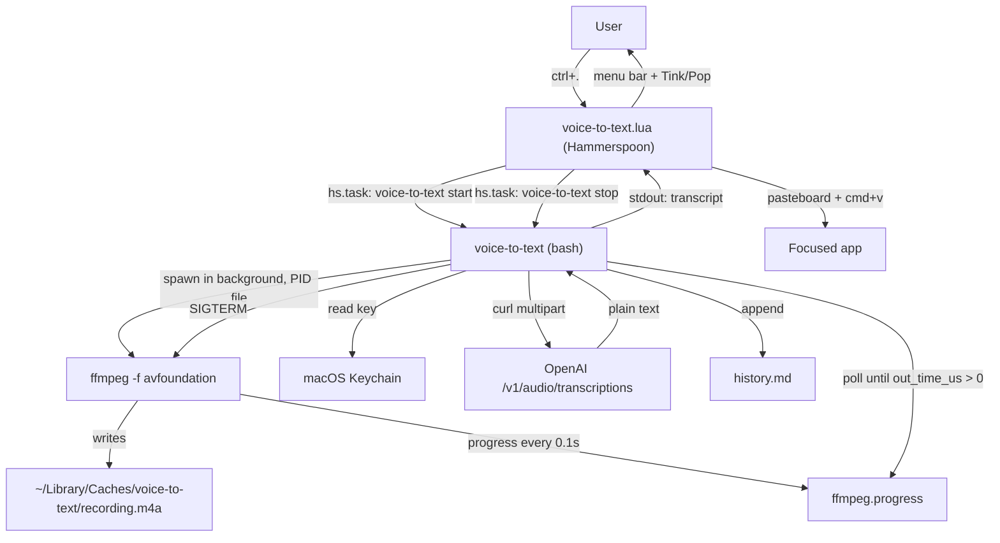
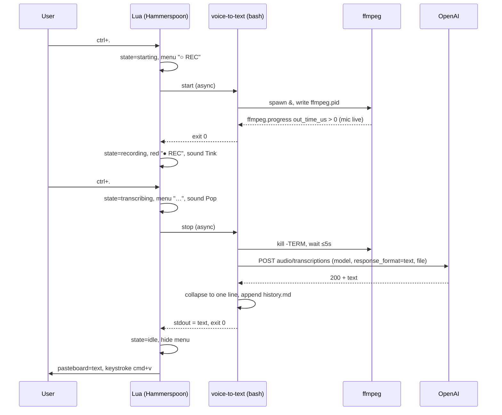

# voice-to-text — Software Specification
> Reverse-engineered from source code.
> Version: 1.1 | Date: 2026-10-19 | Source: `jm-avila/voice-to-text-macos`, branch `dev`
> 1.1: `start` waits until the mic delivers audio; `starting` state, red `● REC` and sound cues for start/stop.

---

## 1. Project Summary
A push-to-talk dictation tool for macOS. Press `ctrl+.` to start recording the microphone, press it again to stop; the audio is sent to the OpenAI transcription API and the text is pasted where the cursor is. It is for people who want system-wide dictation in any app and any language, using a better model than the built-in macOS dictation.

## 2. Tech Stack
| Layer             | Technology                                   | Version                              | Evidence (file)                  |
|-------------------|----------------------------------------------|--------------------------------------|----------------------------------|
| OS                | macOS                                        | Tested on 27.0.1 [INFERRED: any recent macOS] | `avfoundation`, `security`, `say` in code |
| Hotkey / UI layer | Hammerspoon (Lua)                            | 1.1.1 installed; not pinned          | `voice-to-text.lua`, `install.sh` |
| CLI / core        | Bash                                         | 3.2-compatible (macOS system bash)   | `voice-to-text` shebang `#!/usr/bin/env bash` |
| Audio capture     | ffmpeg (`avfoundation` input, AAC encoder, `-progress` report) | 9.0.2 installed; not pinned | `voice-to-text:64-66`            |
| HTTP              | curl (multipart upload)                      | system                               | `voice-to-text:94`               |
| Transcription     | OpenAI `POST /v1/audio/transcriptions`       | model `gpt-4o-transcribe` (default)  | `voice-to-text:26,94-96`         |
| Secrets           | macOS Keychain (`security` CLI)              | system                               | `voice-to-text:53-57`            |
| Sound cues        | macOS system sounds via `hs.sound`           | `Tink`, `Pop` from `/System/Library/Sounds` | `voice-to-text.lua:17,39-46`  |
| Package manager   | Homebrew (`ffmpeg`, `--cask hammerspoon`)    | —                                    | `install.sh:26-28`               |
| Tests             | Plain bash with fake `ffmpeg` and `curl`     | —                                    | `test.sh`                        |
| Database / Auth / State mgmt / Hosting | None. Local-only tool.  | —                                    | —                                |

## 3. Repository Structure
```
voice-to-text-macos/
├── voice-to-text      — Bash CLI: start/stop recording, transcribe, history. All core logic.
├── voice-to-text.lua  — Hammerspoon module: global hotkey, state machine, menu-bar indicator, sound cues, paste.
├── install.sh         — Idempotent setup: brew deps, Hammerspoon hook, API key, launch at login.
├── test.sh            — Tests with fake ffmpeg/curl; `--live` hits the real API.
├── README.md          — User docs.
├── SPEC.md            — This specification.
├── LICENSE            — MIT, 2026 Jose Avila.
└── .gitignore         — Ignores *.m4a, *.wav, history.md, .DS_Store.
```

## 4. Architecture
Two layers with a process boundary between them:

- **UI layer (Lua, Hammerspoon):** owns the hotkey, the user-facing state (`idle | starting | recording | transcribing`), the menu-bar title, sound cues, alerts and the paste. It never touches audio or the network.
- **Core layer (Bash CLI):** owns recording, transcription, persistence. Stateless between calls except for files on disk (PID file, audio file, progress file, history). Usable on its own from a terminal.

The Lua layer calls the CLI asynchronously with `hs.task` and reads its exit code, stdout (transcript) and stderr (error message). That is the whole contract between the two. `start` exiting 0 means the mic is live, which is what lets Lua show `● REC` at the right moment.



### Sequence (happy path)


## 5. Data Models
No database. State is files on disk plus one Lua table.

### Lua module `M` (`voice-to-text.lua:9-17`)
| Field      | Type   | Value / Constraints                                 | Notes |
|------------|--------|-----------------------------------------------------|-------|
| `script`   | string | Path of `voice-to-text` next to the `.lua` file      | Resolved via `debug.getinfo(1, "S").source` |
| `hotkey`   | table  | `{ mods = { "ctrl" }, key = "." }`                   | Edit and reload to change |
| `state`    | string | `"idle" \| "starting" \| "recording" \| "transcribing"` | In-memory only; lost on Hammerspoon reload |
| `sounds`   | table  | `{ start = "Tink", stop = "Pop" }`                   | `/System/Library/Sounds` names; `false` mutes |

Exported as global `VoiceToText` and returned from `dofile`.

### Menu-bar titles (`voice-to-text.lua:24-28`)
| State          | Menu bar             |
|----------------|----------------------|
| `idle`         | Removed from menu bar |
| `starting`     | `○ REC` (mic opening; don't talk yet) |
| `recording`    | `● REC` in red (mic live) |
| `transcribing` | `…`                  |

### On-disk files (`voice-to-text:27-35`)
| File                 | Path (default)                                              | Lifecycle |
|----------------------|-------------------------------------------------------------|-----------|
| PID file             | `$VTT_DIR/ffmpeg.pid`                                       | Created on `start`, deleted on `stop`. Its existence + live PID = "recording". |
| Audio                | `$VTT_DIR/recording.m4a`                                    | Deleted at `start`, replaced each recording. Kept after `stop` (allows retry with `transcribe`). |
| ffmpeg log           | `$VTT_DIR/ffmpeg.log`                                       | Overwritten each `start`. Used in error messages. |
| ffmpeg progress      | `$VTT_DIR/ffmpeg.progress`                                  | Deleted each `start`; ffmpeg appends a key=value block every 0.1 s. `start` reads it to detect a live mic. |
| History              | `$VTT_HISTORY` = `~/Library/Application Support/voice-to-text/history.md` | Append-only, never pruned. |

`$VTT_DIR` defaults to `~/Library/Caches/voice-to-text`.

### Audio format (`voice-to-text:64-66`)
Mono (`-ac 1`), 16 kHz (`-ar 16000`), AAC (`-c:a aac`) at 48 kbps (`-b:a 48k`) in `.m4a`. ≈6 KB/s.

### History entry format (`voice-to-text:107`)
```markdown
## 2026-09-27 13:14:48

Hello, this is a test of the voice-to-text tool.

```
Header `## YYYY-MM-DD HH:MM:SS` (local time), blank line, one-line transcript, blank line. Empty transcripts are not saved.

## 6. API / Interface Reference

### 6.1 CLI (`voice-to-text`, `voice-to-text:124-133`)
| Command                | Behaviour | stdout | Exit |
|------------------------|-----------|--------|------|
| `start`                | Fails if already recording. Removes old audio and progress file, spawns ffmpeg in background, writes PID, then waits until `ffmpeg.progress` shows `out_time_us` > 0 (polls every 0.05 s, up to `VTT_START_TIMEOUT`, default 10 s). | — | 0; 1 with `already recording`, `ffmpeg failed to start: <log>` or `microphone did not start within <N>s` (ffmpeg is killed) |
| `stop`                 | Stops recording, transcribes, saves history, prints text. | Transcript (no trailing newline) | 0; 1 with `not recording`, `empty recording: <log>`, `no API key…`, `request failed`, `API error <code>: <body>` |
| `toggle`               | `stop` if recording, else `start`. | As above | As above |
| `status`               | — | `recording` or `idle` (also `recording` while `start` is still waiting for the mic) | 0 |
| `transcribe FILE`      | Transcribes any audio file. Does **not** write history. | Transcript | 0; 1 with `no audio file: FILE` or API errors |
| `history [N]`          | Prints last N history entries (default 10). | Markdown entries | 0 (prints `no history yet: <path>` to stderr if missing) |
| `-h`, `--help`         | Prints header comment (lines 2–21). | Usage | 0 |
| anything else          | Usage. | Usage | 1 |

All errors go to stderr as `voice-to-text: <message>` (`die`, line 42).

### 6.2 Lua module (`voice-to-text.lua`)
| Function     | Behaviour |
|--------------|-----------|
| `M.start()`  | Sets state `starting`, runs `start`. On exit 0 (mic live): state `recording`, plays `M.sounds.start`. On non-zero exit: state `idle`, `hs.alert` with stderr. |
| `M.stop()`   | Sets state `transcribing`, plays `M.sounds.stop` (capture ends when `stop` sends SIGTERM, right after), runs `stop`. On finish: state `idle`. Non-zero exit → alert stderr. Empty stdout → alert `nothing heard`. Otherwise `hs.pasteboard.setContents(out)` then `hs.eventtap.keyStroke({ "cmd" }, "v")`. |
| `M.toggle()` | `idle` → `start`; `recording` → `stop`; `starting`, `transcribing` → ignored. Bound to the hotkey. |

### 6.3 External API call (`voice-to-text:94-99`)
```
POST {OPENAI_BASE_URL}/audio/transcriptions
Authorization: Bearer <key>
Content-Type: multipart/form-data
  model=<VTT_MODEL>
  response_format=text
  file=@recording.m4a
```
- Success: HTTP 200, body is plain text.
- The script appends `\n%{http_code}` with `curl -w` and splits on the last newline to get status and body.
- Non-200: `die "API error $code: $body"`.
- Post-processing: newlines → spaces, leading/trailing whitespace trimmed (`voice-to-text:101`).

## 7. Key Features & How They Work

### Feature: Global toggle hotkey
- **Entry point:** `hs.hotkey.bind(M.hotkey.mods, M.hotkey.key, M.toggle)` (`voice-to-text.lua:94`).
- **Logic lives in:** `M.toggle` (`voice-to-text.lua:86-92`).
- **Data flow:** keypress → `toggle` → `start`/`stop` → `hs.task` (async) → callback updates state.
- **Notable detail:** the CLI runs async, so Hammerspoon's UI never blocks while the mic opens or during the network call. Presses during `starting` and `transcribing` are dropped.

### Feature: Background recording
- **Entry point:** `voice-to-text start` (`voice-to-text:59-78`).
- **Data flow:** `ffmpeg … -progress ffmpeg.progress -stats_period 0.1 &` → `$!` to `ffmpeg.pid` → poll every 0.05 s: ffmpeg alive (`kill -0`) and `out_time_us=[1-9]` in the progress file.
- **Why wait for audio:** opening the mic took 4.2 s cold (first use after idle) and ~0.25 s warm on a MacBook Pro; speech before that is lost. `out_time_us` turns positive ~0.25 s after capture begins, so the "live" signal is slightly late, never early.
- **Notable detail:** recording state lives in the PID file, not in a long-running process. `is_recording` = PID file exists **and** `kill -0 <pid>` succeeds, so a stale PID file after a crash reads as `idle`.
- `-nostdin` keeps ffmpeg from reading the terminal; `-loglevel error` keeps the log short.

### Feature: Start and stop cues
- **Logic lives in:** `M.start`, `M.stop`, `setState`, `play` (`voice-to-text.lua:22-84`).
- **Data flow:** press → `○ REC` → `start` exits 0 → red `● REC` + `M.sounds.start`. Press again → `…` + `M.sounds.stop` → `stop`.
- **Why the stop cue plays on the press:** capture ends when `stop` sends SIGTERM, tens of ms after the press. Measured: the file length matched the time from mic-live to stop press, with no audio lost at the end.
- **Notable detail:** sound objects are cached in a table so a playing sound is not garbage-collected. The start sound plays while the mic is live, so it may be recorded; the transcriber ignores it.

### Feature: Clean stop
- **Entry point:** `stop_recording` (`voice-to-text:80-88`).
- **Data flow:** `kill -TERM <pid>` → poll `kill -0` every 0.1 s, up to 50 times (5 s) → delete PID file → fail if audio file is empty.
- **Notable detail:** `SIGTERM`, not `SIGINT`. Background jobs started by a non-interactive bash script ignore `SIGINT`, so ffmpeg would never finalize the file. `SIGTERM` makes ffmpeg write the AAC trailer and exit.

### Feature: Transcription
- **Logic lives in:** `transcribe` and `api_key` (`voice-to-text:53-57,90-102`).
- **Data flow:** key lookup → `curl -F` multipart upload → status check → one-line text on stdout.
- **Notable detail:** Hammerspoon does not load the shell profile, so env vars like `OPENAI_API_KEY` usually aren't set. The key is read from the Keychain instead; the env var wins if present. Same reason the script pins `PATH` to include `/opt/homebrew/bin` and `/usr/local/bin` (line 24) so `ffmpeg` is found.

### Feature: Paste at cursor
- **Logic lives in:** `M.stop` callback (`voice-to-text.lua:81-82`).
- **Data flow:** transcript → system pasteboard → synthetic `cmd+v` to the focused app.
- **Notable detail:** the transcript stays on the clipboard after pasting (previous clipboard content is not restored). Needs Accessibility permission for the keystroke.

### Feature: History
- **Logic lives in:** `save_history` and `history` (`voice-to-text:104-122`).
- **Data flow:** on successful `stop` with non-empty text → append timestamped Markdown entry.
- **Notable detail:** `history N` uses one `awk` pass: counts `## ` headers, tags every line with its entry number, prints lines whose entry number is in the last N.

### Feature: Installer
- **Entry point:** `install.sh`.
- **Steps (all idempotent):**
  1. Require Homebrew; `brew install ffmpeg` if missing; `brew install --cask hammerspoon` if `/Applications/Hammerspoon.app` is missing.
  2. Ensure `~/.hammerspoon/init.lua` has `require("hs.ipc")` (enables the `hs` CLI) and `dofile("<repo>/voice-to-text.lua")`. If another `voice-to-text.lua` path is already loaded, leave it and print a note.
  3. If the Keychain item is missing, prompt silently (`read -rsp`) for the key and store it (via the `secret` CLI if installed, else `security add-generic-password -U`).
  4. `chmod +x voice-to-text`, `open -a Hammerspoon`, wait 2 s, then via `hs -c`: `hs.autoLaunch(true)` and `hs.reload()`. Each `hs` call is capped at 5 s with `perl -e 'alarm 5; exec @ARGV'` because `hs` can hang during reload.
  5. Print the two permissions to grant manually.

## 8. State Management
Two independent sources of truth:

| Where | What | Survives |
|-------|------|----------|
| Lua `M.state` | UI state for the hotkey and menu bar | Nothing; reset to `idle` on reload |
| `ffmpeg.pid` + live process | Whether a recording is in progress | Hammerspoon reloads; not reboots (PID dead → `idle`) |

The Lua layer does not query `status`; it assumes its own state is right. See §13 for the drift case.

## 9. Authentication & Authorization
- **Auth strategy:** OpenAI API key as Bearer token.
- **Storage:** macOS Keychain generic password, service `OPENAI_API_KEY`, account `agent-secrets` (shared with the author's `secret` CLI). Override with env `OPENAI_API_KEY`.
- **Lookup:** `security find-generic-password -a agent-secrets -s OPENAI_API_KEY -w` (`voice-to-text:55`).
- **No users, roles or protected endpoints.** Local single-user tool.
- **macOS permissions (TCC), granted to Hammerspoon:**
  - Accessibility: to send `cmd+v`.
  - Microphone: ffmpeg runs as a child of Hammerspoon, so the prompt is for Hammerspoon. Asked on first recording.

## 10. Environment Variables
None are required. All have defaults. Shell env vars do **not** reach Hammerspoon; to change them for the hotkey, edit the defaults at the top of `voice-to-text`.

| Variable          | Required | Default                                                   | Purpose |
|-------------------|----------|-----------------------------------------------------------|---------|
| `OPENAI_API_KEY`  | No       | Keychain item                                             | Overrides Keychain key |
| `VTT_MODEL`       | No       | `gpt-4o-transcribe`                                       | Transcription model (README lists `gpt-transcribe`, `gpt-4o-mini-transcribe`, `whisper-1`) |
| `VTT_MIC`         | No       | `:default`                                                | avfoundation audio device. List: `ffmpeg -f avfoundation -list_devices true -i ""` |
| `VTT_DIR`         | No       | `~/Library/Caches/voice-to-text`                          | PID, audio, log and progress files |
| `VTT_HISTORY`     | No       | `~/Library/Application Support/voice-to-text/history.md`  | History file |
| `VTT_START_TIMEOUT` | No     | `10`                                                      | Seconds `start` waits for mic audio before failing (integer) |
| `OPENAI_BASE_URL` | No       | `https://api.openai.com/v1`                               | Any OpenAI-compatible transcription endpoint |

Source: `voice-to-text:16-35`.

Lua-side settings are fields of `M`, edited in `voice-to-text.lua`: `M.hotkey`, `M.sounds`.

## 11. How to Run Locally
```bash
# Install
git clone https://github.com/jm-avila/voice-to-text-macos.git
cd voice-to-text-macos
./install.sh
# Then: System Settings → Privacy & Security → Accessibility → Hammerspoon (on)
# Microphone is asked on first ctrl+.

# Use
# ctrl+.  start recording: wait for red ● REC + Tink, then talk
# ctrl+.  stop (Pop), transcribe, paste

# CLI without Hammerspoon
./voice-to-text start      # returns once the mic is live
./voice-to-text stop
./voice-to-text transcribe some.m4a
./voice-to-text history 3

# Reload after editing the Lua file
hs -c 'hs.reload()'

# Tests (no mic, no network)
bash test.sh
# Plus one real API call (uses `say` to generate audio)
bash test.sh --live
```

Test coverage (`test.sh`, 25 checks, all pass on 2026-10-19): status transitions, double start, stop when idle, transcript trimming/one-lining, API error surfacing, `start` waits for a live mic, mic timeout (fails, idle, no ffmpeg left), ffmpeg launch failure, missing file, history append/skip-empty/last-N/timestamp format/no-history. The test copies the script and rewrites its pinned `PATH` line so the fake `ffmpeg`/`curl` win. The fake ffmpeg writes `out_time_us=N/A` to the `-progress` file at once and `out_time_us=64000` after `FAKE_MIC_DELAY`; `FAKE_NO_AUDIO` and `FAKE_FFMPEG_FAIL` cover the failures.

Manual check of the Lua layer (2026-10-19): drove `VoiceToText.toggle()` through `hs -c` with the paste stubbed. Real mic: speech started the moment the state turned `recording` was transcribed from its first word. Fake backend: Hammerspoon screenshots of all four menu-bar states looked right.

## 12. Replication Guide
Build it in this order; each step is testable before the next.

1. **Prerequisites.** macOS, Homebrew, `brew install ffmpeg`, `brew install --cask hammerspoon`, an OpenAI API key.
2. **Record from the terminal.** Confirm the mic works:
   `ffmpeg -f avfoundation -i ":default" -ac 1 -ar 16000 -c:a aac -b:a 48k test.m4a` (stop with `q`).
3. **Transcribe once with curl.**
   `curl https://api.openai.com/v1/audio/transcriptions -H "Authorization: Bearer $KEY" -F model=gpt-4o-transcribe -F response_format=text -F file=@test.m4a`
4. **Store the key in Keychain.** `security add-generic-password -U -a <account> -s <service> -w 'sk-...'`; read with `security find-generic-password -a <account> -s <service> -w`.
5. **Write the CLI** (`voice-to-text`, bash, `set -euo pipefail`):
   - Pin `PATH` to include Homebrew dirs.
   - `start`: spawn ffmpeg with `&` and `-progress <file>`, save `$!` to a PID file, wait until the progress file shows `out_time_us` > 0 (timeout → kill ffmpeg, fail).
   - `stop`: `kill -TERM` (not INT), poll until exit (≤5 s), remove PID file, check the file is non-empty.
   - `transcribe`: curl with `-w '\n%{http_code}'`, split status from body, fail on non-200, collapse to one trimmed line.
   - `history`: append `## <timestamp>\n\n<text>\n\n`; read back last N with awk.
   - Errors: one `die` helper → stderr + exit 1.
6. **Write tests** with fake `ffmpeg` (reports audio in its `-progress` file after a delay, writes bytes on SIGTERM) and fake `curl` (prints `$FAKE_BODY\n$FAKE_CODE`) placed first on `PATH`.
7. **Write the Hammerspoon module:**
   - Resolve the script path from the Lua file's own location.
   - `hs.task.new(script, callback, args):start()` for async calls.
   - Four-state machine (`idle`, `starting`, `recording`, `transcribing`); ignore presses while starting or transcribing.
   - `hs.menubar` title per state (red `hs.styledtext` for recording); `hs.sound` cue when the mic is live and on stop; `hs.alert.show` for errors.
   - On success: `hs.pasteboard.setContents(text)`, `hs.eventtap.keyStroke({ "cmd" }, "v")`.
   - `hs.hotkey.bind({ "ctrl" }, ".", M.toggle)`.
8. **Hook into Hammerspoon:** add `dofile("/abs/path/voice-to-text.lua")` to `~/.hammerspoon/init.lua`, reload, grant Accessibility and Microphone.
9. **Write the installer** last, automating steps 1, 4 and 8 idempotently (check before each change; `require("hs.ipc")` to enable `hs -c`; enable `hs.autoLaunch(true)`).

## 13. Gaps & Observations
- **Author-specific Keychain naming:** the key lives under service `OPENAI_API_KEY` / account `agent-secrets`, and `install.sh` uses the author's `secret` CLI if present. Older installs used service `openai-api-key` / account `$USER` and must re-store the key. For other users a neutral account name is clearer.
- **`status` during start:** `status` says `recording` while `start` is still waiting for the mic, because it only checks the PID. Lua does not use `status`, so the hotkey UI is unaffected.
- **No pre-roll:** speech before the mic is live is still lost; the fix only makes that moment visible. A cold mic can take ~4 s. Keeping the mic open all the time would avoid it, at the cost of a permanent mic indicator.
- **Progress file grows during recording:** ffmpeg appends a block every 0.1 s (~2.5 KB/s, ~150 KB per minute). It is deleted on the next `start`.
- **State drift:** if Hammerspoon reloads mid-recording, Lua resets to `idle` while ffmpeg keeps recording. The next `ctrl+.` calls `start`, which fails with `already recording` and leaves Lua at `idle` again; the hotkey is stuck until `./voice-to-text stop`. `M.toggle` could query `status` instead of trusting `M.state`.
- **Clipboard overwritten:** paste uses the pasteboard and does not restore the previous contents.
- **Key visible in process list:** the key is passed as a `curl -H` argument, so it shows in `ps` for the request's duration. Passing headers via `-H @file` or stdin avoids this.
- **No recording length limit:** there is no cap or warning. OpenAI rejects files over 25 MB (≈70 min at 48 kbps). [UNCLEAR - needs review] whether `gpt-4o-transcribe` has a shorter duration limit.
- **Stop timeout:** if ffmpeg doesn't exit within 5 s, the PID file is still removed and the process may be orphaned.
- **No language or prompt parameter:** the API's `language`/`prompt` fields are not used; language is auto-detected.
- **History is plaintext and unbounded:** every transcript is kept forever in `~/Library/Application Support`.
- **`history N` not validated:** a non-numeric N is passed straight to awk.
- **No automated Lua tests:** `test.sh` covers only the bash CLI. The Hammerspoon layer is checked by hand through `hs -c` (see §11).
- **Installer checks only `/Applications/Hammerspoon.app`:** an install elsewhere (e.g. `~/Applications`) triggers a reinstall attempt.
- **Versions not pinned:** Homebrew installs the latest ffmpeg and Hammerspoon.
